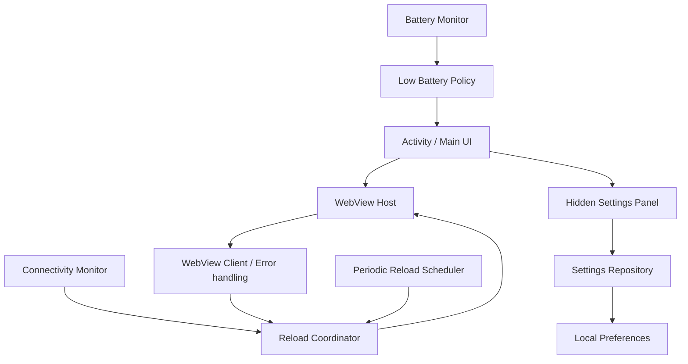

# Technical Architecture

## 1. Recommended stack
- **Language:** Kotlin.
- **Platform:** Native Android app, Android Studio/Gradle build system.
- **UI:** Native Android UI (Compose is a reasonable choice; agent may choose XML layouts if simpler and justified). Keep the gesture/settings experience straightforward.
- **Web renderer:** Android `WebView`.
- **Preferences:** Android Preferences DataStore (or an equally lightweight supported persistence choice).
- **Connectivity:** `ConnectivityManager` and lifecycle-managed network callbacks.
- **Battery:** Battery status APIs/broadcasts, lifecycle-aware.
- **Tests:** Unit tests for logic; Android instrumentation/UI tests where practical; real-device ADB verification.
- **No backend:** All configuration is local.

Kotlin is preferred over Python, Rust, Go, or a cross-platform framework because this is a native Android UI and lifecycle/WebView/immersive/battery/network integration project. Native APIs and platform tooling reduce integration overhead. Java remains viable but is not preferred for new Android work. Rust/Go would add JNI or other integration complexity without meaningful benefit for the small UI-centric application.

## 2. Architecture overview

## 3. Components
- **Main Activity/UI:** hosts the WebView, applies fullscreen and keep-awake flags, manages settings reveal gesture and UI state.
- **Settings panel:** URL, network-recovery toggle, periodic refresh toggle/interval, battery threshold and action, save/return controls.
- **Settings repository:** validates and persists preferences; exposes state.
- **WebView host:** navigation, loading, lifecycle, error display, renderer recovery. Avoid unsafe bridges and permissive file access.
- **Connectivity monitor:** uses system connectivity callbacks, unregisters correctly, and reports transitions rather than relying on deprecated polling.
- **Reload coordinator:** coalesces reload triggers, avoids concurrent/repeated reloads, and centralizes reload reason logging.
- **Periodic scheduler:** preferably lifecycle-aware in-app scheduling while foreground; evaluate whether timer should pause when app is not foregrounded. Do not introduce WorkManager solely for foreground page refresh unless the requirement expands to background work.
- **Battery monitor/policy:** obtains battery level and applies an explicitly defined action. Device-specific screen-off limitations must be evaluated on the connected phone.

## 4. Data flow
Settings saved → repository validates and persists → UI observes changes → WebView loads URL and monitor/scheduler behavior is updated. Connectivity restored or WebView error → reload coordinator applies debounce and conditions → WebView reload. Battery event → policy evaluates threshold → invokes permitted action and communicates any fallback state.

## 5. Settings model (conceptual)
- URL string (unset until first-run setup).
- Reload on connectivity restoration: Boolean.
- Reload on WebView connectivity failure: Boolean (may share a user-facing recovery option if behavior is clear).
- Periodic reload enabled: Boolean.
- Periodic interval: integer plus unit or normalized duration.
- Low-battery threshold: integer percentage.
- Low-battery action: enumerated action whose semantics are supported on the device.
- Optional recovery cooldown/debounce parameters may be internal constants, not user-facing settings.

## 6. WebView considerations
- Use safe browsing support where available.
- Allow ordinary HTTP/HTTPS navigation only by default; handle non-web URI schemes explicitly and safely.
- Do not accept SSL errors or suppress certificate validation.
- Restrict file access and JavaScript interfaces.
- Decide whether JavaScript is enabled based on target-site compatibility; it may be necessary for modern sites but should not be enabled without documenting the security trade-off.
- Handle loading indicator, WebView errors, back navigation only if explicitly desired, and renderer death.
- Keep screen awake through activity window flag while foreground; screen-on flags are not a substitute for kiosk lockdown.
- Fullscreen/immersive mode is best-effort and can be interrupted by Android system gestures or policies.

## 7. Hidden gesture
Use a carefully tested left-edge swipe detector (starting within a configurable narrow edge region, moving inward past distance/velocity threshold). Avoid consuming ordinary touch interactions unless gesture is recognized. Consider Compose gesture handling or a small custom view. Settings panel should be overlay/drawer-like and reversible.

## 8. Battery policy feasibility
A normal application cannot reliably and universally power off the display on demand without special device-admin/device-owner permissions or manufacturer-specific APIs. The agent must inspect the device and Android version, evaluate supported mechanisms, and choose an honest fallback. Locking the device may require Device Admin permission and user setup, while device-owner kiosk controls require provisioning. Do not automatically provision device owner, change system settings, or lock the device without user authorization. A black/dim UI is not the same as powering off the screen; label it accurately.

## 9. Testing and device
Requester supplied an ADB-connected device identifier: `ab082808`. Before tests, run `adb devices -l` and inspect `adb shell getprop ro.build.version.release`, `adb shell getprop ro.build.version.sdk`, and manufacturer/model properties. Confirm serial still exists and is authorized. Build/install/launch and test on device where feasible. Do not use ADB to alter unrelated device settings or wipe data. Record evidence and limitations.

## 10. Trade-offs
- Native Kotlin yields best access to Android lifecycle, WebView, gestures, network, and battery APIs; a cross-platform framework offers little value for this narrow app.
- WebView avoids a separate browser engine dependency, but behavior is tied to Android System WebView updates and site compatibility.
- Immersive fullscreen is not equivalent to managed-device lock task mode.
- Foreground timers are simple and appropriate; robust background scheduling would introduce complexity and may not reliably keep a web page active.
- Device Admin/Device Owner capabilities improve kiosk controls but impose provisioning and user consent/authorization steps and are outside MVP unless expressly approved.

## 11. References
- Android WebView API: https://developer.android.com/reference/kotlin/android/webkit/WebView
- Keep screen on: https://developer.android.com/develop/background-work/background-tasks/awake/screen-on
- Lock task mode: https://developer.android.com/work/dpc/dedicated-devices/lock-task-mode
